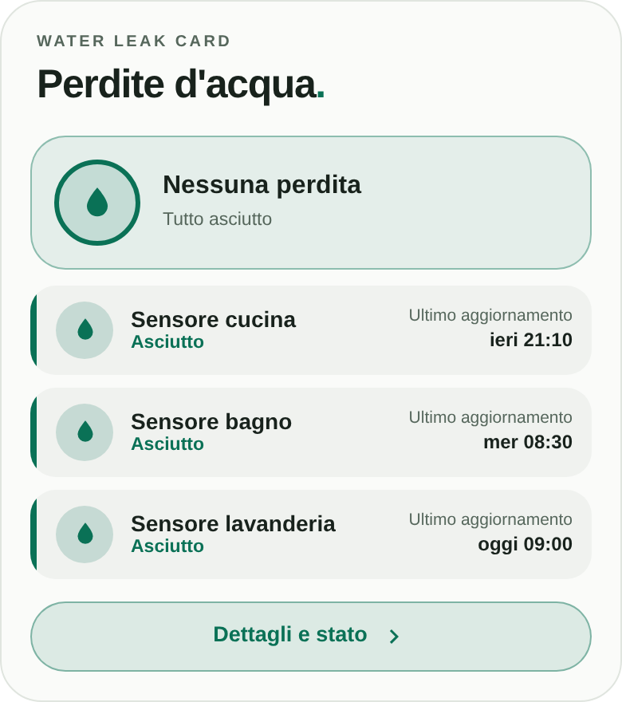
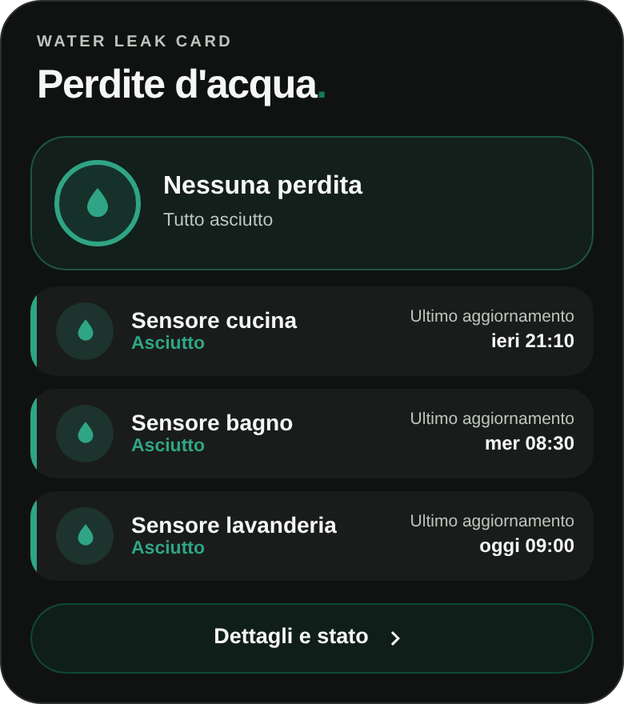
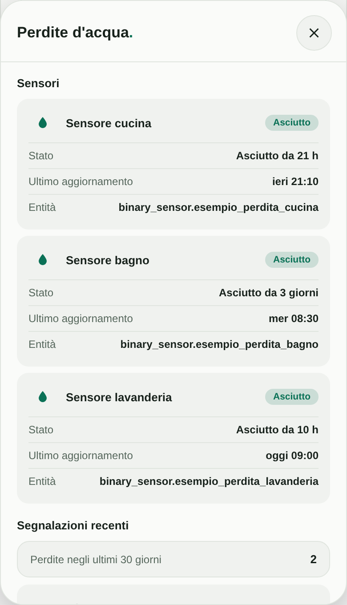

# Water Leak Card

[](https://www.hacs.xyz/docs/faq/custom_repositories/)
[](LICENSE)
[](https://github.com/luigi-regolo/water-leak-card/stargazers)

## Overview

**Water Leak Card** is a custom card for Home Assistant dashboards that shows the status of your water leak sensors, designed with a minimalist interface inspired by the Edera Light and Dark visual styles.

It gives a clear overall status, the state of each sensor, and the time of its last update, in a compact and responsive layout. The card is read-only and never sends commands to your devices.

The card uses `binary_sensor` entities already available in Home Assistant. It does not require a dedicated account, paid APIs, or additional cloud services.

## Preview







*Previews use fictional demo data. The interface text is currently in Italian.*

## Features

- **Overall status:** A summary showing whether there is a leak, whether all sensors are dry, or whether the check is incomplete because a sensor is unavailable.
- **Sensor list:** One row per sensor with its name, its state (dry, leak, or unavailable), and the date and time of its last update.
- **Details popup:** State, time since the last change, last update, and entity ID for each sensor.
- **Recent leak reports:** The number and details of leak reports in the last 30 days, when the Home Assistant history is available.
- **Unavailable sensors:** An unavailable or unknown sensor is never shown as dry.
- **Sensor selection:** Choose the `binary_sensor` entities to show and, optionally, a custom name for each one.
- **Optional elements:** The header label, the title, the last update, the **Dettagli e stato** button and the recent reports can each be turned on or off.
- **Visual configuration:** Configure the card through the Home Assistant dashboard editor, without writing YAML.
- **Edera appearance:** Automatic, Light, and Dark themes with Home Assistant Material Design Icons.
- **Responsive layout:** A responsive interface for desktop, smartphone, and tablet dashboards.

## Installation

### HACS — Custom repository

1. Open **HACS** in Home Assistant.
2. Open the menu and select **Custom repositories**.
3. Enter the repository URL:

   `https://github.com/luigi-regolo/water-leak-card`

4. Select **Dashboard** as the repository type and add it.
5. Find **Water Leak Card** in HACS and download it.
6. Reload the Home Assistant dashboard if necessary.
7. Add the card using the visual editor.

The repository contains `hacs.json` and the distributable JavaScript module `dist/water-leak-card.js`.

### Manual installation

1. Download `dist/water-leak-card.js` from the GitHub repository.
2. Copy it to the `www` directory of your Home Assistant configuration as `water-leak-card.js`.
3. Open **Settings → Dashboards → Resources** in Home Assistant.
4. Add the following resource:

   `/local/water-leak-card.js`

5. Select **JavaScript module** as the resource type.
6. Reload the dashboard and add the card.

If the `www` directory was just created, Home Assistant may need to be restarted before the file becomes accessible.

## Configuration and Usage

### Visual editor

Open a dashboard in edit mode, add **Water Leak Card** and configure it. The card starts empty and shows **Nessun sensore** until you choose at least one sensor. The editor has two sections:

- **Sensori:** search for `binary_sensor` entities in Home Assistant, add the ones you want, give them an optional name, and remove them with the X button.
- **Aspetto:** header label and title (each can be turned on or off), theme, last update, details button and recent reports.

### Example YAML configuration

The card can be configured entirely through the visual editor. The following example uses fictional entity identifiers:

```yaml
type: custom:water-leak-card
entities:
  - entity: binary_sensor.perdita_cucina_demo
    name: Cucina
  - entity: binary_sensor.perdita_bagno_demo
theme_mode: auto
```

### Main configuration options

| Option | Description |
|---|---|
| `title` | Main card title. |
| `eyebrow` | Small header label above the title. |
| `theme_mode` | `auto`, `light` or `dark`. |
| `entities` | Leak sensors to show. Each item is a `binary_sensor.*` entity ID or an object with `entity` and an optional `name`. |
| `show_title` | Show the title. Default: `true`. |
| `show_eyebrow` | Show the header label. Default: `true`. |
| `show_last_update` | Show the last update on each sensor. Default: `true`. |
| `show_details` | Show the **Dettagli e stato** button and its popup. Default: `true`. |
| `show_history` | Show the recent leak reports in the popup. Default: `true`. |

### How states are shown

- **`on`:** Leak.
- **`off`:** Dry.
- **Any other state, or a missing entity:** Unavailable.

The date shown for each sensor is the time of its last state change in Home Assistant.

## Compatibility and Requirements

- Home Assistant with support for custom JavaScript dashboard modules.
- One or more `binary_sensor` entities that report a leak with `on` and no leak with `off`.
- Optional: the Home Assistant history (Recorder), to show the recent leak reports.
- No additional libraries, subscriptions or cloud services.

No specific minimum Home Assistant version has been independently verified or declared for this repository.

## Privacy and Security

The card is read-only: it never calls services or sends commands. It uses only the entity states, history and permissions already available in Home Assistant, and it contains no telemetry, analytics, remote scripts or external assets.

Leak status is provided for informational purposes only. The card does not send notifications; use Home Assistant automations for alerts. An unknown or unavailable status must not be interpreted as confirmation that there is no leak, and the card is not a substitute for dedicated safety devices.

## Copyright & License

Copyright © 2026 luigi-regolo.

Original project created and maintained by **luigi-regolo**.

Licensed under the **GNU General Public License version 3 only (GPL-3.0-only)**.

See the [LICENSE](LICENSE) file for the complete license terms.

The software is provided without warranty to the extent permitted by applicable law.
